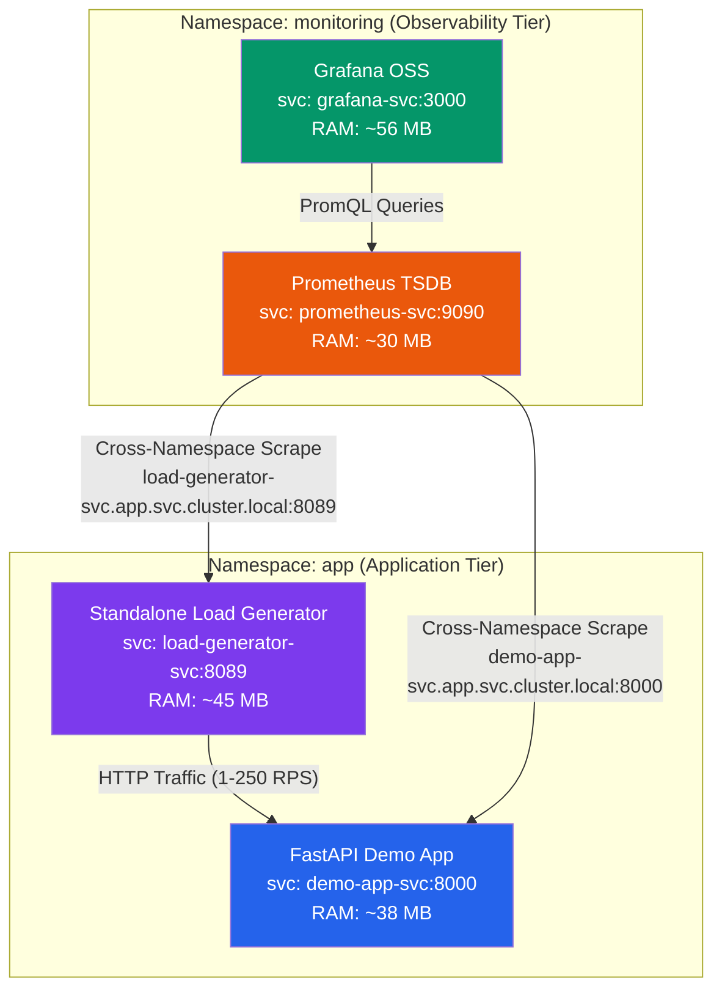

# Ultra-Low Resource Monitoring Stack 🚀 (v2.0)

A complete, production-grade monitoring and load testing stack designed specifically for **local laptop development** with an ultra-lean memory footprint (~220 MB total RAM across all 4 services).

Version 2.0 introduces an enterprise-grade **2-namespace architecture (`app` + `monitoring`)**, a **dedicated asynchronous Load Generator module** with live TPS (Transactions Per Second) telemetry, concurrency control, 7 pre-built traffic scenarios, and pre-provisioned Grafana dashboards.

---

## 🌟 What's New in Version 2.0 (v1 vs v2 Complete Breakdown)

| Feature / Capability | Version 1.0 (Legacy) | **Version 2.0 (Current)** |
| :--- | :--- | :--- |
| **Kubernetes Workload Isolation** | Single flat namespace (`monitoring`) | **2 Namespaces**: `app` (application & loadgen) + `monitoring` (Prometheus & Grafana) |
| **Load Generation Architecture** | Embedded `threading.Thread` loop inside the demo app | **Dedicated standalone container** (:8089) built with `asyncio` & `aiohttp` |
| **Metric Isolation** | Generator competed with app; metrics were polluted | **Completely isolated**; client-side and server-side metrics are distinct |
| **Throughput & TPS Control** | None (hardcoded sleep intervals) | **Target RPS slider (1–250)** with token-bucket rate limiter |
| **Concurrency Control** | None (single thread) | **Virtual Users slider (1–50 VU)** governed via `asyncio.Semaphore` |
| **Live Hot-Updating** | None (restart required) | **Hot-update RPS & concurrency on the fly** without stopping (`POST /api/load/update`) |
| **Pre-Built Traffic Scenarios** | 0 (only a single start/stop toggle) | **7 Pre-Built Scenarios**: Steady State, Ramp-Up, Spike Burst, Error Storm, Latency Soak, Chaos, Canary |
| **Grafana Dashboards** | 1 Dashboard (*App Performance*) | **2 Pre-Provisioned Dashboards**: *Load Generator & TPS Analytics* + enhanced *App Performance & Health* |
| **TPS Telemetry in Grafana** | ❌ None | **✅ Full TPS Tracking**: Achieved TPS vs Target RPS overlay, Delivery Efficiency % gauge |
| **Client-Side Latency Metrics** | ❌ None | **✅ Client Percentiles**: p50, p90, p95, p99 histograms and latency heatmap |
| **Failure Classification** | Generic counter | **Categorized Errors**: timeouts, connection refused, 4xx, 5xx |
| **Server-Side Saturation** | ❌ None | **In-flight requests gauge**, payload sizes, uptime, USD revenue tracking |
| **Total Memory Footprint** | ~120 MB RAM | **~220 MB RAM** across 4 containers (still 98% less than OTel Demo's 16,000 MB!) |

---

## 🏛️ Multi-Namespace Enterprise Architecture



> [!TIP]
> **Why 2 Namespaces?** Separating `app` from `monitoring` reflects enterprise production standards. In the future, you can deploy microservices, databases, or service meshes into the `app` namespace without cluttering or altering the observability infrastructure.

---

## 📊 Resource Consumption Comparison

| Component | OpenTelemetry Astronomy Demo | **Lightweight Stack v2.0** |
| :--- | :--- | :--- |
| **Number of Pods** | 34 pods (Java, Kafka, OpenSearch, etc.) | **4 pods** across 2 namespaces |
| **Total Memory (RAM)** | ~12,000 MB - 16,000 MB | **~220 MB total** (98% reduction!) |
| **CPU Consumption** | 4 - 8 CPU Cores | **< 0.08 CPU Cores** |
| **Local Laptop Heat / Battery** | Extreme fan noise & battery drain | Silent, zero laptop battery impact |

### Live Measured Container Stats:
- **Grafana OSS**: ~56 MB RAM (0.06% CPU)
- **Standalone Load Generator**: ~45 MB RAM (0.35% CPU at 50 RPS)
- **FastAPI Demo App**: ~38 MB RAM (0.28% CPU)
- **Prometheus**: ~30 MB RAM (0.96% CPU)

---

## ⚡ One-Line Deploy (Helm v2.0)

Deploy the full dual-namespace stack in one command:

```bash
# Add the Helm repo
helm repo add lightweight-monitoring https://hrushikeshkuwlekar.github.io/lightweight-monitoring-stack/
helm repo update

# Install the full stack (automatically creates 'app' and 'monitoring' namespaces)
helm install demo lightweight-monitoring/lightweight-monitoring-stack
```

Then port-forward to access the services:
```bash
make port-forward
```

Or port-forward manually:
```bash
kubectl port-forward svc/demo-app-svc       -n app 8000:8000 &
kubectl port-forward svc/load-generator-svc  -n app 8089:8089 &
kubectl port-forward svc/grafana-svc         -n monitoring 3000:3000 &
kubectl port-forward svc/prometheus-svc      -n monitoring 9090:9090 &
```

### Inspect Pods across Namespaces:
```bash
kubectl get pods -n app
kubectl get pods -n monitoring
```

### Customize with values:
```bash
helm install demo lightweight-monitoring/lightweight-monitoring-stack \
  --set namespaces.app="my-custom-app" \
  --set namespaces.monitoring="my-custom-monitoring" \
  --set demoApp.replicaCount=2
```

---

## 🌐 Quick Access URLs

| Service | Local URL | Namespace | Description |
| :--- | :--- | :--- | :--- |
| **Load Generator UI** | [http://localhost:8089](http://localhost:8089) | `app` | 🎛️ Target RPS (1–250), Concurrency (1–50 VU), 7 test scenarios, live TPS sparkline |
| **Grafana: Load & TPS** | [http://localhost:3000/d/loadgen-analytics](http://localhost:3000/d/loadgen-analytics) | `monitoring` | 📊 Real-time TPS tracking, Target vs Achieved RPS, Delivery %, Client p50–p99 latency |
| **Grafana: App Health** | [http://localhost:3000](http://localhost:3000) | `monitoring` | 📈 Server Golden RED metrics, in-flight saturation, error spikes, USD order revenue |
| **Interactive Demo App** | [http://localhost:8000](http://localhost:8000) | `app` | ⚡ Demo App landing page to trigger manual requests and inspect endpoints |
| **Prometheus UI** | [http://localhost:9090](http://localhost:9090) | `monitoring` | 🔥 Scrape targets across namespaces, PromQL explorer, and alert rules |
| **Loadgen Metrics** | [http://localhost:8089/metrics](http://localhost:8089/metrics) | `app` | Prometheus scrape endpoint for load generator |
| **App Metrics** | [http://localhost:8000/metrics](http://localhost:8000/metrics) | `app` | Prometheus scrape endpoint for demo app |

---

## 🎛️ Load Generator Features & Pre-Built Scenarios

The standalone load generator includes **7 pre-configured production scenarios**:

1. **`steady-state`** (10 RPS, 5 VU): Baseline production traffic. Indefinite run.
2. **`ramp-up`** (0→50 RPS, 30 VU): 2-minute linear climb, 3-minute hold, 1-minute ramp-down.
3. **`spike-test`** (100 RPS burst, 50 VU): Sudden traffic spike to evaluate auto-scaling and alert responsiveness.
4. **`error-storm`** (20 RPS, 90% errors): High rate of 500-errors to trip the `HighErrorRate` alert in Prometheus.
5. **`latency-soak`** (15 RPS, 70% slow queries): Sustained slow responses to trip `p95 LatencySpike` alert.
6. **`chaos`** (60 RPS, random mix): Unpredictable jitter, dynamic delays, and error bursts.
7. **`canary-compare`** (20 RPS, 50/50 split): Even split between fast order processing and latency queries.

### CLI One-Liners:
```bash
make simulate    # Run steady-state scenario
make spike       # Fire 100 RPS traffic spike
make stop-load   # Stop active load test
```

---

## 📂 Project Structure

```
.
├── app/                          # FastAPI demo application
│   ├── Dockerfile                # Multi-stage Docker build
│   ├── main.py                   # Application source code & UI
│   └── requirements.txt          # Python dependencies
├── load-generator/               # ⭐ Standalone Load Generator module
│   ├── Dockerfile                # Container build (:8089)
│   ├── main.py                   # Async load engine, control API & UI
│   ├── scenarios.py              # Pre-built load profiles
│   └── requirements.txt          # aiohttp, fastapi, prometheus-client
├── grafana/                      # Grafana provisioning & dashboards
│   ├── dashboards/
│   │   ├── demo-app-dashboard.json   # Enhanced App Performance dashboard
│   │   └── loadgen-dashboard.json    # Dedicated TPS Analytics dashboard
│   └── provisioning/
│       ├── dashboards/provider.yaml
│       └── datasources/prometheus.yaml
├── prometheus/                   # Prometheus configuration
│   ├── alerts.yml                # Alerting rules (errors, latency, load)
│   └── prometheus.yml            # Multi-namespace scrape targets
├── helm/                         # ⭐ Helm chart v2.0.0
│   └── lightweight-monitoring-stack/
│       ├── Chart.yaml            # Chart metadata (v2.0.0)
│       ├── values.yaml           # Multi-namespace configuration
│       └── templates/
│           ├── namespaces.yaml   # Creates 'app' and 'monitoring' namespaces
│           ├── demo-app.yaml     # Deployed to 'app' namespace
│           ├── load-generator.yaml # Deployed to 'app' namespace
│           ├── prometheus.yaml   # Deployed to 'monitoring' namespace
│           └── grafana.yaml      # Deployed to 'monitoring' namespace
├── k8s/                          # Raw Kubernetes manifests (2 namespaces)
│   ├── 00-namespace.yaml         # Creates 'app' and 'monitoring'
│   ├── 01-app.yaml               # Demo App in 'app'
│   ├── 02-prometheus.yaml        # Prometheus in 'monitoring' (cross-scrapes 'app')
│   ├── 03-grafana.yaml           # Grafana in 'monitoring' (dual dashboards)
│   └── 04-load-generator.yaml    # Load Generator in 'app'
├── .github/workflows/
│   └── release.yml               # CI/CD: Builds multi-arch images & publishes Helm v2
├── docker-compose.yml            # Docker Compose 4-container stack
└── Makefile                      # Multi-namespace convenience targets
```

---

## ⚡ Deployment Methods

### 1. Raw Kubernetes Manifests (Dual Namespace)
```bash
make up            # Applies k8s/ creating 'app' and 'monitoring' namespaces
make status        # Inspect pods in both namespaces
make port-forward  # Port forward all 4 services
make down          # Clean tear-down
```

### 2. Helm Chart (Publishable v2.0.0)
```bash
helm install demo helm/lightweight-monitoring-stack
make port-forward
```

### 3. Docker Compose (Quickest Local Run)
```bash
make compose-up    # Runs 4-container stack locally
make compose-down
```

---

## 📜 License

MIT
