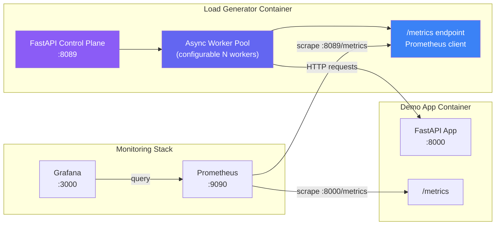

# 🔥 Professional Load Generator Module — Implementation Plan

## Executive Summary

Transform the current embedded traffic simulator (a simple toggle button + `urllib` loop inside `main.py`) into a **standalone, containerized Load Generator service** with full concurrency control, real-time TPS measurement, and a dedicated Grafana dashboard that maps all load-testing metrics professionally.

---

## Current State Analysis

| Aspect | Current Implementation | Problem |
|---|---|---|
| **Architecture** | Traffic loop runs *inside* the demo-app via `threading.Thread` | Load generator competes for resources with the app it's testing; metrics are polluted |
| **Concurrency** | Single thread, hardcoded `time.sleep(0.3-0.8)` | No control over concurrent users, RPS, or ramp patterns |
| **Metrics** | Only 3 counters (`total_sent`, `errors_sent`, `slow_sent`) tracked in a Python dict | No TPS, no latency histograms from the client side, no Prometheus export |
| **UI Controls** | One toggle button (Start/Stop) | No way to adjust RPS, concurrency, duration, or traffic mix |
| **Grafana** | Only server-side panels exist | Zero load-generator dashboards — no TPS timeline, no client-perceived latency, no saturation view |

---

## Architecture (After)



> [!IMPORTANT]
> The load generator becomes a **4th container** in the stack. The demo-app stays clean — it only serves requests and exposes its own metrics. Separation of concerns.

---

## Phase 1 — Load Generator Service (New Container)

### 1.1 New Directory: `load-generator/`

```
load-generator/
├── Dockerfile
├── requirements.txt
├── main.py            # FastAPI control-plane + async workers
└── scenarios.py       # Pre-built load profiles (ramp, spike, steady, chaos)
```

### 1.2 Core Prometheus Metrics Emitted by Load Generator

These are **client-side** metrics (observed from the load generator's perspective), complementing the server-side metrics already in demo-app:

| Metric Name | Type | Labels | Purpose |
|---|---|---|---|
| `loadgen_requests_total` | Counter | `method`, `endpoint`, `status_code`, `scenario` | Total requests sent |
| `loadgen_request_duration_seconds` | Histogram | `endpoint`, `status_code` | Client-perceived latency distribution (buckets: 5ms → 10s) |
| `loadgen_requests_in_flight` | Gauge | — | Currently active concurrent requests |
| `loadgen_target_rps` | Gauge | — | The configured target RPS (for overlay on Grafana) |
| `loadgen_achieved_rps` | Gauge | — | Actual measured RPS over last sliding window |
| `loadgen_errors_total` | Counter | `error_type` (`timeout`, `connection_refused`, `http_5xx`, `http_4xx`) | Errors broken down by category |
| `loadgen_concurrent_users` | Gauge | — | Current number of virtual users / worker coroutines |
| `loadgen_scenario_active` | Gauge | `scenario_name` | 1 if a named scenario is running, 0 otherwise |
| `loadgen_bytes_sent_total` | Counter | — | Total request payload bytes |
| `loadgen_bytes_received_total` | Counter | — | Total response payload bytes |
| `loadgen_connection_pool_size` | Gauge | — | Current HTTP connection pool utilization |

### 1.3 Control-Plane API (`:8089`)

| Endpoint | Method | Description |
|---|---|---|
| `GET /` | GET | Load Generator UI (rich HTML control panel) |
| `GET /health` | GET | Health check |
| `GET /metrics` | GET | Prometheus scrape endpoint |
| `POST /api/load/start` | POST | Start load test with configuration body |
| `POST /api/load/stop` | POST | Stop all running load |
| `GET /api/load/status` | GET | Current run state, live TPS, active workers |
| `POST /api/load/update` | POST | Hot-update RPS/concurrency without stopping |
| `GET /api/scenarios` | GET | List available pre-built scenarios |
| `POST /api/scenarios/{name}/run` | POST | Run a named scenario |
| `GET /api/history` | GET | Last N run summaries |

### 1.4 Load Configuration Schema

```json
{
  "target_url": "http://demo-app:8000",
  "duration_seconds": 300,
  "ramp_up_seconds": 30,
  "ramp_down_seconds": 15,
  "concurrency": 20,
  "target_rps": 50,
  "traffic_mix": {
    "GET /api/order?tier=gold": 55,
    "GET /api/order?tier=silver": 15,
    "GET /api/order?tier=bronze": 5,
    "GET /api/slow?delay=0.8": 15,
    "GET /api/error": 10
  },
  "timeout_seconds": 5,
  "scenario": "custom"
}
```

### 1.5 Pre-Built Scenarios

| Scenario Name | Description | Behavior |
|---|---|---|
| `steady-state` | Normal production traffic | 10 RPS, 5 workers, 80/10/10 mix, runs indefinitely |
| `ramp-up` | Gradual load increase | 0→50 RPS over 2min, hold 3min, ramp down 1min |
| `spike-test` | Sudden traffic burst | Steady 5 RPS, then 100 RPS spike for 30s, recover |
| `error-storm` | Trigger error alerts | 90% error traffic at 20 RPS for 60s |
| `latency-soak` | P95 degradation | 70% slow queries at 15 RPS for 5min |
| `chaos` | Unpredictable mix | Random RPS (5-80), random mix, random pauses |
| `canary-compare` | A/B traffic split | 50/50 split between two endpoint variants |

### 1.6 Async Worker Pool Design

```python
# Simplified architecture — not final code
class LoadEngine:
    """asyncio-based load generator with token-bucket rate limiting."""

    def __init__(self, config: LoadConfig):
        self.config = config
        self.semaphore = asyncio.Semaphore(config.concurrency)
        self.rate_limiter = TokenBucket(config.target_rps)
        self.session = aiohttp.ClientSession(...)  # connection pooling
        self.running = False
        self._tps_window = deque(maxlen=1000)  # sliding window for TPS calc

    async def worker(self):
        """Single virtual user — loops sending requests."""
        while self.running:
            await self.rate_limiter.acquire()
            async with self.semaphore:
                endpoint = self._pick_endpoint()  # weighted random
                start = time.monotonic()
                try:
                    resp = await self.session.get(endpoint, timeout=...)
                    duration = time.monotonic() - start
                    # Record Prometheus metrics
                    LOADGEN_REQUESTS_TOTAL.labels(...).inc()
                    LOADGEN_DURATION.labels(...).observe(duration)
                    self._tps_window.append(time.monotonic())
                except Exception as e:
                    LOADGEN_ERRORS_TOTAL.labels(error_type=classify(e)).inc()

    async def start(self, num_workers: int):
        self.running = True
        tasks = [asyncio.create_task(self.worker()) for _ in range(num_workers)]
        # Ramp-up: add workers gradually
        ...

    def get_current_tps(self) -> float:
        """Calculate TPS from sliding window."""
        now = time.monotonic()
        cutoff = now - 1.0
        recent = [t for t in self._tps_window if t > cutoff]
        return len(recent)
```

> [!TIP]
> Using `aiohttp` + `asyncio.Semaphore` gives us true concurrency control without threads. The token-bucket rate limiter ensures we hit the target RPS precisely.

---

## Phase 2 — Demo App Cleanup & New Server-Side Metrics

### 2.1 Remove Embedded Simulator from `main.py`

Delete from [`main.py`](file:///Users/hrushikeshkuwlekar/Desktop/DemoApp/app/main.py):
- `traffic_worker()` function (L134-160)
- `toggle_simulator()` endpoint (L162-169)
- `simulator_status()` endpoint (L171-173)
- All `simulator_running` / `simulator_stats` globals (L51-52)
- The Auto-Traffic Generator card from HTML (the simulator toggle UI)

Replace with a **link to the Load Generator UI** at `:8089`.

### 2.2 New Server-Side Metrics (Added to Demo App)

Enhance [`main.py`](file:///Users/hrushikeshkuwlekar/Desktop/DemoApp/app/main.py) with additional professional metrics:

| Metric | Type | Purpose |
|---|---|---|
| `http_requests_in_flight` | Gauge | Currently processing requests (saturation signal) |
| `http_request_size_bytes` | Histogram | Request payload size distribution |
| `http_response_size_bytes` | Histogram | Response payload size distribution |
| `app_uptime_seconds` | Gauge | Time since process start |
| `app_info` | Info/Gauge | Build version, Python version (for annotations) |
| `app_orders_value_total` | Counter | Simulated dollar value of orders (`tier` label) |
| `app_circuit_breaker_state` | Gauge | 0=closed, 1=open (simulated) |
| `http_request_duration_seconds` | Histogram | **Add p99 bucket** (currently tops at 5s, add 10s) |

---

## Phase 3 — Grafana Dashboard Overhaul

### 3.1 Dashboard Architecture: Two Dashboards

#### Dashboard 1: **"App Performance & Health"** (Enhanced Existing)

Keep the existing dashboard but expand it significantly:

| Row | Panels | Description |
|---|---|---|
| **Row 1: Golden Signals** | 4 stat panels | RPS, Error Rate %, P95 Latency, Saturation (in-flight) |
| **Row 2: Request Volume** | Timeseries + Pie | Requests/sec by status code (timeseries) + Traffic distribution by endpoint (pie chart) |
| **Row 3: Latency Deep-Dive** | Timeseries + Heatmap | P50/P95/P99 latency (timeseries) + Latency heatmap (shows distribution over time) |
| **Row 4: Error Analysis** | Timeseries + Stat | Error rate over time (timeseries) + Total error count (stat) + Error by endpoint (table) |
| **Row 5: Business Metrics** | Timeseries + Stat | Orders/sec by tier (stacked bars) + Total orders (stat) + Simulated revenue (stat) |
| **Row 6: Resource Utilization** | Gauge + Timeseries | Memory gauge + Uptime + Active connections over time |

#### Dashboard 2: **"Load Generator Control & TPS"** (Brand New)

| Row | Panels | Description |
|---|---|---|
| **Row 1: Live Load Status** | 4 stat panels | Current TPS (achieved), Target RPS, Active Concurrent Users, Requests In-Flight |
| **Row 2: TPS Timeline** | Timeseries (main panel) | `loadgen_achieved_rps` vs `loadgen_target_rps` overlaid — shows if you're hitting target |
| **Row 3: Client-Side Latency** | Timeseries + Heatmap | Client-observed P50/P95/P99 latency + Latency distribution heatmap |
| **Row 4: Throughput Breakdown** | Timeseries + Pie | Requests/sec by endpoint (stacked area) + Traffic mix pie chart |
| **Row 5: Error Analysis** | Timeseries + Table | Client errors by type (timeout/5xx/connection) + Error log table |
| **Row 6: Saturation & Capacity** | Timeseries + Gauge | Connection pool usage + In-flight gauge + Achieved vs Target (% efficiency) |
| **Row 7: Scenario Timeline** | Annotation overlay | Marks when scenarios start/stop, RPS changes, as Grafana annotations |

### 3.2 Key Grafana Queries (PromQL)

```promql
# ---- TPS Metrics (Load Generator Dashboard) ----

# Achieved TPS (real-time)
sum(rate(loadgen_requests_total[30s]))

# Target vs Achieved overlay
loadgen_target_rps
sum(rate(loadgen_requests_total[30s]))

# TPS by endpoint
sum by (endpoint) (rate(loadgen_requests_total[30s]))

# Client P95 Latency
histogram_quantile(0.95, sum(rate(loadgen_request_duration_seconds_bucket[1m])) by (le))

# Client P99 Latency
histogram_quantile(0.99, sum(rate(loadgen_request_duration_seconds_bucket[1m])) by (le))

# Error rate from client perspective
sum(rate(loadgen_errors_total[1m])) / sum(rate(loadgen_requests_total[1m])) * 100

# Saturation: in-flight requests
loadgen_requests_in_flight

# Connection efficiency
loadgen_achieved_rps / loadgen_target_rps * 100

# ---- Enhanced App Dashboard ----

# Server-side saturation
http_requests_in_flight

# P99 Latency (new bucket)
histogram_quantile(0.99, sum(rate(http_request_duration_seconds_bucket[1m])) by (le))

# Latency heatmap
sum(increase(http_request_duration_seconds_bucket[30s])) by (le)
```

---

## Phase 4 — Load Generator UI (Served at `:8089`)

A rich, professional control panel embedded in the load generator service:

### UI Sections

1. **Quick Launch Bar** — Pre-built scenario buttons (Steady, Ramp, Spike, Chaos) with one-click start
2. **Custom Configuration Panel** — Sliders/inputs for:
   - Target RPS (1–500, slider + input)
   - Concurrency / Virtual Users (1–100, slider)
   - Duration (30s–30min, or indefinite)
   - Ramp-up time (0s–5min)
   - Traffic mix editor (percentage sliders per endpoint)
   - Timeout threshold
3. **Live Metrics Dashboard** — Real-time counters:
   - Current TPS (large animated number)
   - Active Workers
   - Total Requests Sent
   - Success / Error / Timeout counts
   - P50 / P95 / P99 latency (live)
   - Running duration
4. **Activity Log** — Scrollable event log (scenario started, RPS changed, errors detected)
5. **Links** — Direct links to Grafana Load Generator dashboard & App dashboard

---

## Phase 5 — Infrastructure Changes

### 5.1 Docker Compose Update

Add the load-generator service to [`docker-compose.yml`](file:///Users/hrushikeshkuwlekar/Desktop/DemoApp/docker-compose.yml):

```yaml
load-generator:
  build:
    context: ./load-generator
    dockerfile: Dockerfile
  image: load-generator:v1
  container_name: load-generator
  ports:
    - "8089:8089"
  environment:
    - TARGET_URL=http://demo-app:8000
  depends_on:
    - demo-app
  restart: unless-stopped
  deploy:
    resources:
      limits:
        cpus: "0.30"
        memory: 100M
      reservations:
        cpus: "0.05"
        memory: 50M
```

### 5.2 Prometheus Config Update

Add load-generator as a scrape target in Prometheus config:

```yaml
scrape_configs:
  - job_name: 'demo-app'
    metrics_path: '/metrics'
    static_configs:
      - targets: ['demo-app:8000']

  - job_name: 'load-generator'    # NEW
    metrics_path: '/metrics'
    static_configs:
      - targets: ['load-generator:8089']
        labels:
          app: 'load-generator'
          component: 'testing'
```

### 5.3 K8s Manifests

New file: `k8s/04-load-generator.yaml` with Deployment + Service + ConfigMap.

### 5.4 Helm Chart Update

Add `load-generator` templates and values to the existing Helm chart.

---

## Phase 6 — Demo App UI Update

Update the main demo-app landing page at `:8000` to:

1. **Replace** the embedded "Auto-Traffic Generator" card with a **"Load Generator"** card that links to `:8089`
2. **Keep** the manual trigger buttons (200/slow/500) for quick one-off demos
3. **Add** a new "Monitoring Dashboards" section with links to both Grafana dashboards

---

## Implementation Order & Effort

| Step | Task | Files Changed/Created | Effort |
|---|---|---|---|
| **1** | Create `load-generator/` service (core engine + API + metrics) | `load-generator/main.py`, `scenarios.py`, `Dockerfile`, `requirements.txt` | 🔴 Large |
| **2** | Build Load Generator UI | Embedded in `load-generator/main.py` | 🟡 Medium |
| **3** | Add new server-side metrics to demo-app | [`app/main.py`](file:///Users/hrushikeshkuwlekar/Desktop/DemoApp/app/main.py) | 🟢 Small |
| **4** | Remove embedded simulator from demo-app | [`app/main.py`](file:///Users/hrushikeshkuwlekar/Desktop/DemoApp/app/main.py) | 🟢 Small |
| **5** | Update demo-app UI (link to load-gen) | [`app/main.py`](file:///Users/hrushikeshkuwlekar/Desktop/DemoApp/app/main.py) HTML section | 🟢 Small |
| **6** | Create "Load Generator" Grafana dashboard JSON | New dashboard JSON | 🟡 Medium |
| **7** | Enhance existing "App Performance" Grafana dashboard | Dashboard JSON in k8s/helm configs | 🟡 Medium |
| **8** | Update `docker-compose.yml` | [`docker-compose.yml`](file:///Users/hrushikeshkuwlekar/Desktop/DemoApp/docker-compose.yml) | 🟢 Small |
| **9** | Update Prometheus config (add scrape target) | Prometheus config in k8s + compose | 🟢 Small |
| **10** | Create K8s manifest `04-load-generator.yaml` | `k8s/04-load-generator.yaml` | 🟢 Small |
| **11** | Update Helm chart (templates + values) | `helm/lightweight-monitoring-stack/` | 🟡 Medium |
| **12** | Update `README.md` | [`README.md`](file:///Users/hrushikeshkuwlekar/Desktop/DemoApp/README.md) | 🟢 Small |

---

## Complete Metrics Inventory (After Implementation)

### Server-Side (Demo App `:8000/metrics`)

| Metric | Type | Labels |
|---|---|---|
| `http_requests_total` | Counter | `method`, `endpoint`, `status_code` |
| `http_request_duration_seconds` | Histogram | `endpoint` |
| `http_requests_in_flight` | Gauge | — |
| `http_request_size_bytes` | Histogram | `endpoint` |
| `http_response_size_bytes` | Histogram | `endpoint` |
| `app_active_connections` | Gauge | — |
| `app_simulated_memory_mb` | Gauge | — |
| `app_business_orders_total` | Counter | `tier` |
| `app_orders_value_total` | Counter | `tier` |
| `app_uptime_seconds` | Gauge | — |
| `app_info` | Gauge | `version`, `python_version` |

### Client-Side (Load Generator `:8089/metrics`)

| Metric | Type | Labels |
|---|---|---|
| `loadgen_requests_total` | Counter | `method`, `endpoint`, `status_code`, `scenario` |
| `loadgen_request_duration_seconds` | Histogram | `endpoint`, `status_code` |
| `loadgen_requests_in_flight` | Gauge | — |
| `loadgen_target_rps` | Gauge | — |
| `loadgen_achieved_rps` | Gauge | — |
| `loadgen_errors_total` | Counter | `error_type` |
| `loadgen_concurrent_users` | Gauge | — |
| `loadgen_scenario_active` | Gauge | `scenario_name` |
| `loadgen_bytes_sent_total` | Counter | — |
| `loadgen_bytes_received_total` | Counter | — |
| `loadgen_connection_pool_size` | Gauge | — |

---

## Resource Budget

> [!NOTE]
> Keeping the stack lightweight is a core design goal. The load generator is intentionally lean.

| Container | CPU Limit | Memory Limit | Notes |
|---|---|---|---|
| demo-app | 0.20 | 80 MB | Unchanged |
| prometheus | 0.25 | 120 MB | Unchanged |
| grafana | 0.50 | 400 MB | Unchanged |
| **load-generator** | **0.30** | **100 MB** | New — asyncio is very memory-efficient |
| **Total** | **1.25** | **700 MB** | Was 600 MB → +100 MB |

---

## Success Criteria

- [ ] Load generator runs as an independent container
- [ ] Users can control RPS (1–500), concurrency (1–100), and duration via UI
- [ ] Traffic mix is configurable per-run (percentage sliders)
- [ ] Pre-built scenarios (steady, ramp, spike, chaos, error-storm) work one-click
- [ ] TPS (target vs achieved) renders live in Grafana
- [ ] Client-side latency (P50/P95/P99) visible in Grafana
- [ ] Error breakdown by type visible in Grafana
- [ ] Ramp-up/ramp-down visualizes as a smooth curve in Grafana
- [ ] Hot-updating RPS/concurrency mid-test works without restart
- [ ] Total stack stays under 800 MB RAM
- [ ] All existing demo functionality preserved (manual trigger buttons)
